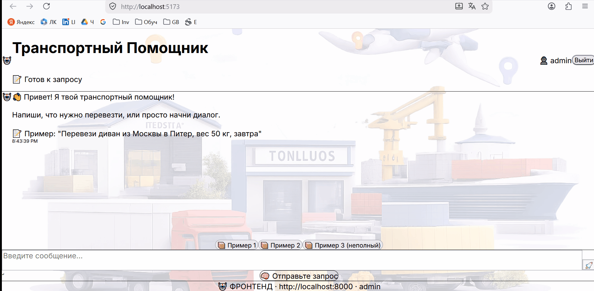

<p align="center">
  
</p>

<h1 align="center" style="color: #3776AB; margin-top: 0px;">🚚 Logistics Platform</h1>

<p align="center" style="font-size: 20px; font-weight: 500; color: #2c3e50; margin-bottom: 10px;">
  Платформа для управления логистикой с AI-ассистентом
</p>


<p align="center">
  <code>🐍 Python</code> &nbsp;
  <code>⚡ FastAPI</code> &nbsp;
  <code>🎸 Django</code> &nbsp;
  <code>🐘 PostgreSQL</code> &nbsp;
  <code>📦 Redis</code> &nbsp;
  <code>🔍 Elasticsearch</code> &nbsp;
  <code>⚛️ React</code> &nbsp;
  <code>⚡ Vite</code> &nbsp;
  <code>📊 React Admin</code> &nbsp;
  <code>🐳 Docker</code> &nbsp;
  <code>🔧 GitHub Actions</code> &nbsp;
  <code>🦀 Ruff</code> &nbsp;
  <code>📝 MyPy</code> &nbsp;
  <code>🔒 Pre-commit</code> &nbsp;
  <code>🧠 Natasha</code> &nbsp;
  <code>🔄 LangGraph</code>
</p>


## 📋 Оглавление

- [Бизнес-контекст](#-бизнес-контекст)
- [Бизнес-проблема](#-бизнес-проблема)
- [Решение](#-решение)
- [Ключевые возможности](#-ключевые-возможности)
- [Документация системного аналитика](#-документация-системного-аналитика)
- [Функционал](#-функционал)
- [Интерфейс](#-интерфейс)
- [Требования к запуску через **Docker** и запуск](#-требования-к-запуску-через-docker-и-запуск)
- [Архитектура, слои проекта для разработчиков](#-архитектура-слои-проекта-для-разработчиков)
- [Технологии](#-технологии)
- [Автор кода](#-автор-кода)


## Бизнес-контекст

| Параметр | Описание |
|----------|--|
| **Предметная область** | Транспортная логистика, грузоперевозки, Supply Chain |
| **Целевая аудитория** | Логисты, менеджеры по перевозкам, операторы заявок |
| **Бизнес-цель** | Сокращение времени обработки заявок с 30 до 5 минут |
| **Ключевая метрика** | Доля автоматически обработанных заявок (целевой показатель — >70%) | 
| **Ожидаемый эффект** | Снижение операционных затрат на 25% (оценка на основе пилотного проекта) |  

## ❗ Бизнес-проблема

В большинстве логистических компаний оформление перевозки происходит **вручную**:

| Этап | Текущий процесс | Проблема |
|------|-----------------|----------|
| 1 | Клиент звонит или пишет менеджеру | Зависимость от человеческого фактора |
| 2 | Менеджер уточняет маршрут, вес, тип груза | Многократные уточнения, потеря времени |
| 3 | Менеджер ищет тариф в справочниках | Ручной поиск, ошибки, нет единой базы |
| 4 | Менеджер рассчитывает стоимость | Возможны арифметические ошибки |
| 5 | Менеджер оформляет заказ в 1С/Excel | Дублирование данных, нет автоматизации |

**⏱️ Итоговое время обработки заявки: 30–60 минут**

## 💡 Решение

Платформа **автоматизирует** процесс оформления перевозки:

**Пользователь пишет сообщение естественным языком:**

> *"Нужно перевезти диван из Москвы в Казань, 50 кг, 20.08.2026"*

**Система автоматически:**
1. ✅ Распознает параметры перевозки (NER)
2. ✅ Определяет города отправления и назначения
3. ✅ Определяет вес груза и дату доставки
4. ✅ Выполняет поиск подходящих тарифов (Elasticsearch)
5. ✅ Рассчитывает стоимость и срок доставки
6. ✅ Предлагает оптимального перевозчика
7. ✅ Оформляет заказ и передает перевозчику

**⏱️ Итоговое время обработки заявки: 2–5 минут**


## 🎯 Ключевые возможности

| Возможность | Описание |
|-------------|----------|
| 🤖 **AI-ассистент** | Обработка запросов на естественном языке, NER, диалоговый режим |
| 📦 **Умный поиск** | Поиск тарифов по маршруту, весу, типу груза через Elasticsearch |
| 🚛 **Несколько перевозчиков** | Выбор оптимального перевозчика с расчетом стоимости и сроков |
| 🔄 **Сквозной процесс** | От заявки до заказа — полностью автоматизировано |
| 📊 **Администрирование** | Управление перевозчиками, тарифами, заказами через React Admin |
| 🔒 **Безопасность** | JWT-авторизация, ролевая модель |


## 📚 Документация системного аналитика

| 🧾 Артефакт | 📖 Описание                                                           | 📁 Где посмотреть |
|-------------|-----------------------------------------------------------------------|-------------------|
| **BRD** | Бизнес-требования: цели, стейкхолдеры, метрики, экономика             | [`01_business_requirements.md`](./docs/requirements/01_business_requirements.md) |
| **User Stories** | Пользовательские сценарии для клиентов, перевозчиков, администраторов | [`02_user_stories.md`](./docs/requirements/02_user_stories.md) |
| **SRS** | Системные требования: FR, AI, NFR, UI, BRULE, DATA, INT               | [`03_system_requirements.md`](./docs/requirements/03_system_requirements.md) |
| **Матрица трассировки** | Связь требований с тест-кейсами                                       | [`04_traceability_matrix.md`](./docs/requirements/04_traceability_matrix.md) |
| **Диаграммы** | BPMN AS-IS/TO-BE, UML (Use Case, Sequence, Component, State), ER, C4   | [📁 Посмотреть все](./docs/diagrams/) |
| **RACI-матрица** | Распределение ответственности по ролям                                | [`raci.md`](./docs/processes/raci.md) |
| **Глоссарий** | Единая терминология предметной области                                | [`glossary.md`](./docs/processes/glossary.md) |
| **API контракт** | Описание API-эндпоинтов, форматов запросов и ответов                  | [`api_contract.md`](./docs/api/api_contract.md) |
| **OpenAPI-спецификация** | Машиночитаемая спецификация API (YAML)                                | [`openapi.yaml`](./docs/api/openapi.yaml) |
| **Postman Collection** | Коллекция запросов для тестирования API                               | [`postman_collection.json`](./docs/api/postman_collection.json) |
| **Тест-сценарии (Gherkin)** | BDD-сценарии для автоматизации тестирования                           | [`test_scenarios.md`](./docs/tests/test_scenarios.md) |
| **Release Notes** | Что нового и что исправлено в релизе                                  | [`release_notes.md`](./docs/release/release_notes.md) |
| **Runbook** | Инструкция для службы поддержки                                       | [`runbook.md`](./docs/release/runbook.md) |
| **Realization Report** | Отчет о достижении бизнес-результатов (KPI)                           | [`realization_report.md`](./docs/release/realization_report.md) |


## ✨ Функционал

### 🤖 AI-Ассистент

- Обработка запросов на естественном языке (NER)
- Распознавание сущностей: города, даты, вес, тип груза
- Интеллектуальный поиск тарифов
- Оформление заказа в диалоговом режиме

### 📦 Логистика

- Поиск тарифов по маршруту и весу
- Фильтрация по типу груза и срочности
- Выбор перевозчика из нескольких вариантов
- Расчет стоимости и сроков доставки

### 🛠️ Администрирование

- Управление перевозчиками
- Создание и редактирование тарифов
- Управление заказами
- Административная панель (React Admin)

### 👤 Пользовательский функционал

- Регистрация и авторизация (JWT)
- Личный кабинет пользователя
- История заказов
- Статусы заказов

### 🔧 Технические возможности

- Автоматическое создание `.env` файла
- Автоматическая загрузка демо-данных
- Логирование всех запросов
- Проверка кода (ruff, mypy)

## 🖥 Интерфейс

<p align="center">
  
</p>

<br>

---

---

## 🚀 Требования к запуску через **Docker** и запуск

### 📦 Требования

Проверьте версии инструментов:

```bash
docker --version
docker compose version
```

### Приложение тестировалось на версиях:

Docker 29.1.5
Docker Compose 5.0.2

### Запуск проекта (ОДНА КОМАНДА!)

**Внимание! Команды just - из Justfile.**

1. Клонируем репозиторий

```bash
git clone https://github.com/anastasiagogohiya/logistics_platform.git
cd logistics_platform

```

2. Запускаем проект (вручную ничего делать не нужно!)

```bash
just up
```

---

При выполнении команды just up автоматически:

- Создается .env файл с автогенерацией секретных ключей
- Создаются Docker образы всех сервисов
- Поднимается PostgreSQL и применяются миграции
- Запускается Redis (кэш + сессии)
- Запускается Elasticsearch (поиск тарифов)
- Запускается FastAPI (AI-агент)
- Запускается Django (бэкенд)
- Запускается Frontend (React + Vite)
- Загружаются демонстрационные данные (тарифы, перевозчики)
- Создается суперпользователь (admin/admin)

### 🌐 Доступные сервисы

<table>
  <tr>
    <th>Сервис</th>
    <th>URL</th>
    <th>Назначение</th>
  </tr>
  <tr>
    <td>🌐 Frontend</td>
    <td>http://localhost:5173</td>
    <td>Чат-интерфейс пользователя</td>
  </tr>
  <tr>
    <td>🚀 FastAPI Docs</td>
    <td>http://localhost:8000/docs</td>
    <td>Документация API агента</td>
  </tr>
  <tr>
    <td>🐍 Django Admin</td>
    <td>http://localhost:8001/admin</td>
    <td>Панель администратора</td>
  </tr>
  <tr>
    <td>⚛️ React Admin</td>
    <td>http://localhost:3001</td>
    <td>Админ-панель логистики</td>
  </tr>
  <tr>
    <td>📊 Redis Commander</td>
    <td>http://localhost:8081</td>
    <td>Управление Redis</td>
  </tr>
  <tr>
    <td>📝 Swagger</td>
    <td>http://localhost:8000/docs</td>
    <td>OpenAPI документация</td>
  </tr>
  <tr>
    <td>🔍 Elasticsearch</td>
    <td>http://localhost:9200</td>
    <td>Поисковый движок</td>
  </tr>
</table>

👤 Доступ по умолчанию
Логин: admin
Пароль: admin

3. Чтобы остановить контейнер

```bash
just down
```

---

### Проверка работы приложения и ❗ Возможные проблемы

Если приложение не запускается, проверьте логи сервисов в реальном времени:

```bash
just logs
```

Предупреждение:
Убедитесь, что порты свободны:

- `5173` - Frontend
- `8000` - FastAPI
- `8001` - Django
- `3001` - React Admin
- `5432` - PostgreSQL
- `6378` - Redis Cache
- `6380` - Redis Storage
- `8081` - Redis Commander
- `9200` - Elasticsearch

Полная очистка и удаление
just clean-all

## Архитектура, слои проекта для разработчиков

Краткая структура проекта:

```text
 logistics_platform/
├── .github/                     # 🤖 CI/CD (GitHub Actions)
│   └── workflows/
│       └── ci.yml               # Автоматическая проверка при push
│
├── .pre-commit-config.yaml      # 🔒 Git хуки (проверка перед коммитом)
│
├── services/                    # Все сервисы
│   ├── fastapi_agent/          # 🤖 AI-агент (NER + диалоги)
│   │   ├── src/
│   │   │   ├── agents/         # Логика диалогов
│   │   │   ├── api/            # HTTP эндпоинты
│   │   │   ├── schemas/        # Pydantic схемы
│   │   │   ├── services/       # Бизнес-логика + NER
│   │   │   └── utils/          # Утилиты
│   │   └── Dockerfile
│   │
│   ├── django_core/            # 🐍 Бэкенд (тарифы, заказы, перевозчики, оплата, пользователи)
│   │   ├── src/
│   │   │   ├── carriers/       # Перевозчики
│   │   │   ├── orders/         # Заказы
│   │   │   ├── tariffs/        # Тарифы + Elasticsearch
│   │   │   ├── payments/       # Платежи
│   │   │   ├── users/          # Пользователи
│   │   │   └── config/         # Настройки Django
│   │   └── Dockerfile
│   │
│   ├── frontend/               # 💬 Чат-интерфейс (React + Vite)
│   │   ├── src/
│   │   │   ├── components/     # React компоненты
│   │   │   └── assets/         # Статика
│   │   └── Dockerfile
│   │
│   └── react-admin/            # ⚛️ Админ-панель (React Admin)
│       ├── src/
│       │   ├── authProvider.ts # Авторизация
│       │   └── dataProvider.ts # API клиент
│       └── package.json
│
├── infra/                      # 🔧 Инфраструктура
│   ├── logging/                # 📝 Логирование (общий пакет)
│   │   └── src/
│   │       └── infra_logging/  # Мидлвары для логов
│   └── redis/                  # 🗄️ Конфигурация Redis
│       ├── cache/              # Redis для кэширования
│       └── storage/            # Redis для сессий
│
├── docker-compose.yml          # 🐳 Оркестрация 9 сервисов
├── justfile                    # 📋 Команды для запуска
├── entrypoint.sh               # 🚀 Точка входа для контейнеров
├── .env.example                # 🔑 Шаблон переменных окружения
└── README.md                   # 📖 Документация проекта        
```

## 🛠 Технологии

### Backend

- **FastAPI** - AI-агент (обработка запросов, NER)
- **Django** - Основной бэкенд (API, админка)
- **PostgreSQL** - Основная база данных
- **Redis** - Кэширование и сессии
- **Elasticsearch** - Поиск тарифов

### AI

- **Natasha** - NER (извлечение сущностей)
- **pymystem3** - Морфологический анализ
- **LangGraph** - Управление диалогами

### Frontend

- **React + Vite** - Пользовательский интерфейс
- **React Admin** - Админ-панель

### DevOps

- **Docker** - Контейнеризация
- **Docker Compose** - Оркестрация
- **GitHub Actions** - CI/CD

### Качество кода

- **Ruff** - Линтер и форматтер
- **Mypy** - Проверка типов
- **Pre-commit** - Git хуки

---

### 👨‍💻 Автор
Anastasiya Gogokhiya
GitHub: @anastasiagogohiya


### ⭐ Благодарности
Natasha - NER библиотека
FastAPI - Современный веб-фреймворк
LangGraph - Управление диалогами
