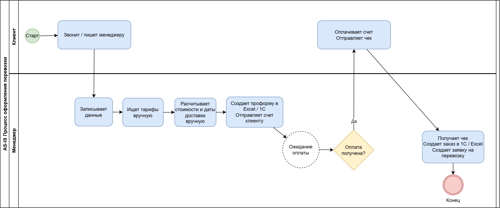
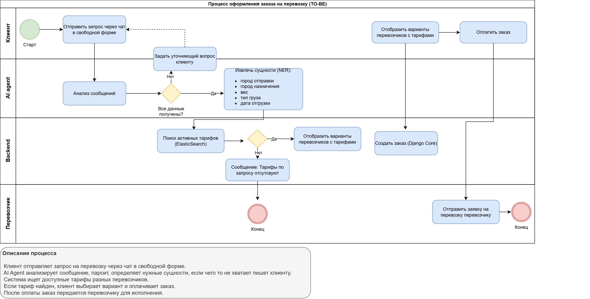

# Logistics Platform

## Business Requirements Document (BRD)

---

| Параметр | Значение |
|----------|----------|
| **Документ** | Business Requirements Document (BRD) |
| **Проект** | Logistics Platform |
| **Версия** | 1.0 |
| **Дата** | 25.07.2026 |
| **Автор** | Анастасия Гогохия |

---

# Содержание

1. Executive Summary 

   1.1. Бизнес-проблема

   1.2. Предлагаемое решение

   1.3. Ожидаемый бизнес-эффект

2. Business Context

   2.1. Предпосылки проекта

   2.2. Причины запуска

   2.3. Анализ альтернатив

3. AS-IS
4. Business Goals

   4.1. Бизнес-модель

   4.2. Экономический эффект
5. TO-BE

6. Scope (границы проекта)

   6.1. In Scope

   6.2. Out of Scope
7. Stakeholder Analysis

   7.1. Пользовательские сегменты
8. Business Requirements
9. Success Metrics
10. Business Risks
11. Business Constraints
12. Assumptions
13. Dependencies
14. Roadmap (сроки и этапы реализации)
15. References
16. Definitions and Glossary
17. Approval

# 1. Executive Summary

## 1.1. Бизнес-проблема
Обработка заявок на перевозку осуществляется вручную и включает получение информации от клиента, поиск подходящих тарифов, расчет стоимости перевозки и оформление заказа.

Такой процесс требует значительного времени, зависит от квалификации оператора и сопровождается риском ошибок при обработке данных.

Среднее время обработки одной заявки составляет **30–60 минут**.

---

## 1.2. Предлагаемое решение
Разработать веб-платформу с AI-ассистентом, позволяющую автоматически обрабатывать заявки на перевозку посредством диалогового интерфейса.

Система должна:
- автоматически определять параметры перевозки из сообщения пользователя;
- подбирать подходящие тарифы;
- предлагать доступных перевозчиков;
- рассчитывать стоимость и сроки доставки;
- автоматически оформлять заказ.

---

## 1.3. Ожидаемый бизнес-эффект

После внедрения платформы предполагается:
- сократить время обработки заявки до **2–5 минут**;
- снизить количество ручных операций;
- уменьшить вероятность ошибок при оформлении заказа;
- увеличить количество одновременно обрабатываемых заявок;
- обеспечить масштабируемость процесса оформления перевозок.

---

# 2. Business Context

## 2.1. Предпосылки проекта

В существующем процессе оформления перевозок наблюдаются следующие проблемы:
- большое количество ручных операций;
- длительный поиск подходящего тариферного предложения;
- человеческий фактор при вводе данных;
- высокая зависимость скорости обработки от загрузки операторов;
- отсутствие единого процесса автоматизированного оформления заказа.

## 2.2. Причины запуска

- увеличение объема ручной обработки заявок вследствие роста количества заказов;
- наличие ошибок при обработке заявок вследствие человеческого фактора;
- рост конкуренции со стороны компаний, использующих автоматизированные решения.

## 2.3. Анализ альтернатив

| Альтернатива | Плюсы | Минусы | Почему не выбрали |
|--------------|-------|--------|-------------------|
| Ручная обработка | Нет затрат на IT | Медленно, ошибки | Не масштабируется |
| Готовый CRM | Быстро внедрить | Дорого, не гибко | Не подходит под процессы |
| Аутсорсинг | Нет найма | Зависимость | Потеря контроля |
| **Своя разработка** | **Полный контроль** | **Дорого, долго** | **Выбрали** |

---

# 3. AS-IS

Текущий процесс выглядит следующим образом.
1. Клиент связывается с менеджером.
2. Менеджер вручную заносит данные по перевозке.
3. Менеджер ищет подходящий тариф.
4. Менеджер создает счет и отправляет клиенту.
5. Менеджер ожидает поступления оплаты.
6. Менеджер оформляет заказ.
7. Менеджер передает заявку на перевозку перевозчику.

Среднее время обработки заявки составляет **30–60 минут**.

Диаграмма процесса представлена ниже.

---

# 4. Business Goals

Проект направлен на достижение следующих бизнес-целей:

| Цель | KPI |
|------|-----|
| Сократить время оформления заявки | менее 5 минут |
| Уменьшить количество ручных операций | автоматизация основных этапов |
| Повысить скорость обслуживания клиентов | увеличение количества обработанных заявок |
| Снизить количество ошибок при оформлении | уменьшение числа ручных исправлений |
| Создать масштабируемую платформу | возможность параллельной обработки большого количества заявок |
| Обеспечить надежную обработку ошибок | минимизация числа прерванных сценариев |

## 4.1. Бизнес-модель

| Источник дохода | Описание | Кто платит |
|-----------------|----------|------------|
| Комиссия с заказа | % от стоимости перевозки | Перевозчик |
| Подписка | Ежемесячная плата за доступ | Клиенты (B2B) |
| Premium-тарифы | Платное продвижение | Перевозчики |

Или:
- Бесплатно для клиентов, комиссия с перевозчиков
- Freemium: базовый функционал бесплатно, расширенный — платно

## 4.2. Экономический эффект

| Показатель | Сейчас | После внедрения | Экономия |
|------------|--------|-----------------|----------|
| Время на заявку | 45 мин | 3 мин | 42 мин |
| Заявок в день на 1 менеджера | 10 | 50 | +40 |
| Ошибок на 100 заявок | 15 | 3 | -12 |
| Стоимость обработки 1 заявки | 500 руб | 50 руб | 450 руб |

При 1000 заявок в месяц:
- Экономия: 1000 × 450 = 450 000 руб/месяц
- Окупаемость: 6-8 месяцев

---

# 5. TO-BE

После внедрения платформы процесс будет следующим.
1. Пользователь пишет запрос на перевозку в свободной форме.
2. Система автоматически определяет параметры перевозки и при необходимости запрашивает недостающие данные.
3. Выполняется автоматический поиск подходящих вариантов перевозки и отправляет варианты для выбора клиенту.
4. Пользователь выбирает вариант тарифа.
5. Система отправляет счет на оплату.
6. Клиент оплачивает
7. Система автоматически распознает оплату.
8. Заказ автоматически создается в системе.

Ожидаемое время обработки заявки составляет **2–5 минут**.

Диаграмма процесса представлена ниже.

---

# 6. Scope
## 6.1. In Scope
Проект включает:
- регистрацию пользователей;
- авторизацию;
- оформление заявки через чат;
- автоматическое определение параметров перевозки;
- поиск подходящих тарифов;
- выбор перевозчика;
- автоматический расчет стоимости;
- автоматический расчет срока доставки;
- создание заказа;
- просмотр истории заказов;
- просмотр статусов заказов;
- административную панель управления тарифами;
- управление перевозчиками;
- управление заказами.

---

## 6.2. Out of Scope
В первую версию проекта не входят:
- мобильное приложение;
- Telegram-бот;
- интеграция с ERP-системами;
- полноценная платежная система;
- электронный документооборот.

---

# 7. Stakeholder Analysis

| Стейкхолдер | Интерес |
|--------------|----------|
| Заказчик | Получение эффективного инструмента автоматизации |
| Руководитель логистики | Сокращение времени обработки заявок |
| Логисты | Минимизация ручной работы |
| Менеджеры по перевозкам | Быстрое оформление заказов |
| Пользователи платформы | Удобный интерфейс оформления перевозок |
| Перевозчики | Получение новых заказов |
| Бухгалтерия | Корректность оформления заказов |
| IT-команда | Поддерживаемая архитектура системы |

## 7.1. Пользовательские сегменты

### Клиент-1: Малый бизнес
- ИП или ООО до 10 сотрудников
- Перевозки 1-2 раза в месяц
- Важно: цена, простота
- Проблема: нет времени разбираться

### Клиент-2: Средний бизнес
- 50-200 сотрудников
- Перевозки 10-20 раз в месяц
- Важно: скорость, надежность, отчетность
- Проблема: долго оформлять

### Клиент-3: Крупный бизнес
- 500+ сотрудников
- Перевозки ежедневно
- Важно: интеграция с ERP, SLA
- Проблема: ручной процесс не масштабируется

---

# 8. Business Requirements

Ниже представлен полный перечень бизнес-требований к системе. Приоритеты определены по методологии MoSCoW:
- **Must** — требование критично для запуска, без него система не работает
- **Should** — важно, но может быть реализовано во второй очереди
- **Could** — желательно, но не критично

| ID                   | Требование                                                                                                                                            | Приоритет |
|----------------------|-------------------------------------------------------------------------------------------------------------------------------------------------------|-----------|
| BR-001               | Система должна обеспечивать оформление заявки через диалоговый интерфейс (AI-чат)                                                                     | Must      |
| BR-002               | Система должна поддерживать простой диалог с пользователем для создания заявки на перевозку                                                           | Must      | 
| BR-003               | Система должна автоматически определять параметры перевозки из текстового сообщения пользователя                                                      | Must      |
| BR-004               | Система должна задавать уточняющие вопросы, если не хватает важного параметра для поиска тарифа                                                       | Must      | 
| BR-005               | Система должна подбирать доступные тарифы в соответствии с параметрами перевозки                                                                      | Must      | 
| BR-006               | Система должна отображать несколько доступных вариантов перевозчиков с ценами и сроками                                                               | Must      | 
| BR-007               | Система должна автоматически рассчитывать стоимость перевозки на основе выбранного тарифа                                                             | Must      | 
| BR-008               | Система должна автоматически рассчитывать предполагаемый срок доставки                                                                                | Must      |
| BR-009               | Система должна создавать заказ без ручного заполнения оператором (на основе выбранного тарифа)                                                        | Must      | 
| BR-010               | Система должна сохранять историю заказов пользователя с возможностью просмотра и фильтрации                                                           | Should    |
| BR-011               | Система должна предоставлять администратору возможность управлять перевозчиками, тарифами и заказами                                                  | Should    | 
| BR-012               | Система должна обеспечивать возможность оплаты заказа через внешний платежный сервис                                                                  | Must      | 
| BR-013               | Система должна корректно обрабатывать ошибки и исключительные ситуации (отсутствие тарифов, отмена заказа, возврат средств, истечение времени оплаты) | Must      |

---

# 9. Success Metrics

| Метрика | Целевое значение |
|-----------|----------------|
| Время обработки заявки | менее 5 минут |
| Доля автоматически оформленных заказов | более 70% |
| Снижение количества ручных операций | более 60% |
| Удовлетворенность пользователей | более 4,5 из 5 |
| Количество успешно оформленных заявок | рост относительно ручного процесса |

---

# 10. Business Risks

| Риск | Способ снижения |
|------|----------------|
| Недостаточная точность автоматического определения параметров | дополнительная валидация данных |
| Недоступность внешних сервисов | резервные сценарии обработки |
| Низкая готовность пользователей | обучение и пилотное внедрение |
| Изменение требований бизнеса | поэтапная поставка функциональности |
| Рост нагрузки | масштабирование инфраструктуры |

---

# 11. Business Constraints

Проект должен соответствовать следующим ограничениям:
- соблюдение требований законодательства РФ по обработке персональных данных;
- доступ к системе только для авторизованных пользователей;
- ведение журнала действий пользователей;
- возможность дальнейшего развития платформы без полной переработки архитектуры.

---

# 12. Assumptions

Предполагается, что:
- пользователи имеют стабильный доступ к сети Интернет;
- пользователи используют современные версии веб-браузеров;
- данные о тарифах перевозчиков регулярно актуализируются;
- внешние сервисы доступны в штатном режиме;
- инфраструктура обеспечивает требуемую производительность системы.

---

# 13. Dependencies

Реализация проекта зависит от следующих внешних компонентов и сервисов:
- API перевозчиков для получения актуальных тарифов;
- сервиса расчета маршрутов;
- платежного сервиса для обработки оплаты;
- сервиса отправки уведомлений пользователям;
- Elasticsearch для поиска и анализа данных;
- Redis для кэширования часто используемой информации.

## 14. Roadmap

### Фаза 1 (MVP) — Месяц 1-2
- Регистрация и авторизация
- Базовый чат с AI
- Подбор тарифов (3-5 перевозчиков)
- Создание заказа

### Фаза 2 — Месяц 3
- Оплата через платежный шлюз
- История заказов
- Админ-панель (базовая)

### Фаза 3 — Месяц 4-5
- Интеграция с API перевозчиков
- Расширенная админка
- Уведомления

### Фаза 4 — Будущее
- Мобильное приложение
- Telegram-бот
- ERP-интеграция

---

# 15. References

В рамках проекта используются следующие связанные документы.

| Документ                                | Описание                        | Расположение                                              |
|-----------------------------------------|---------------------------------|-----------------------------------------------------------|
| Glossary                                | Термины и определения проекта   | [glossary.md](../processes/glossary.md)                   |
| RACI Matrix                             | Матрица ролей и ответственности | [raci.md](../processes/raci.md)                           |
| System Requirements Specification (SRS) | Системные требования            | [03_system_requirements.md](03_system_requirements.md)    |
| User Stories                            | Пользовательские истории        | [03_user_stories.md](02_user_stories.md)                  |
| Traceability Matrix                     | Матрица трассировки             | [04_traceability_matrix](04_traceability_matrix.md)       |
| API Contract                            | Контракт REST API               | [api_contract.md](../api/api_contract.md)                 |
| Test Scenarios                          | Сценарии для тестов             | [test_scenarios.md](../tests/test_scenarios.md)           |
| OpenAPI Specification                   | Спецификация OpenAPI            | [openapi.yaml](../api/openapi.yaml)                       |
| Postman Collection                      | Коллекция запросов API          | [postman_collection.json](../api/postman_collection.json) |

---

# 16. Definitions and Glossary

Термины, сокращения и определения, используемые в настоящем документе, приведены в документе:

**Glossary** — `../processes/glossary.md`

---

# 17. Approval

| Роль | Ответственный | Подпись | Дата |
|------|---------------|---------|------|
| Заказчик | ______________ | ______________ | ______________ |
| Бизнес-заказчик | ______________ | ______________ | ______________ |
| Системный аналитик | Анастасия Гогохия | ______________ | ______________ |