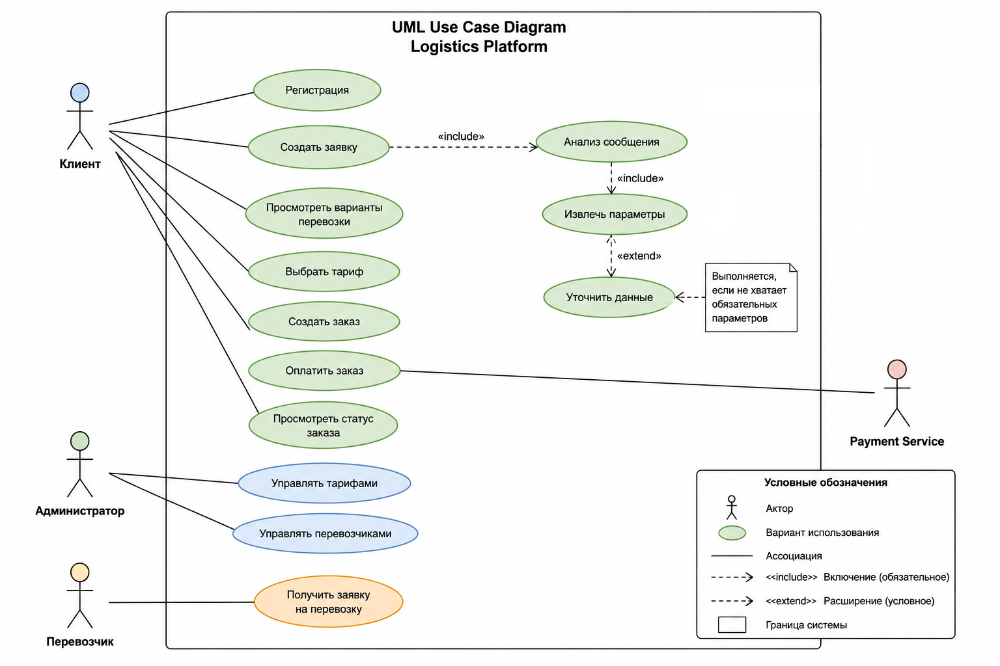
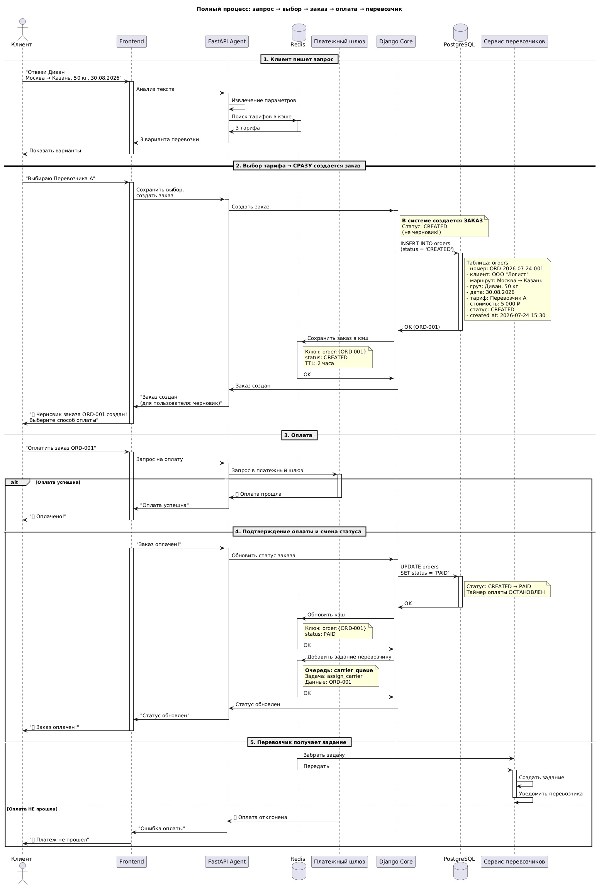
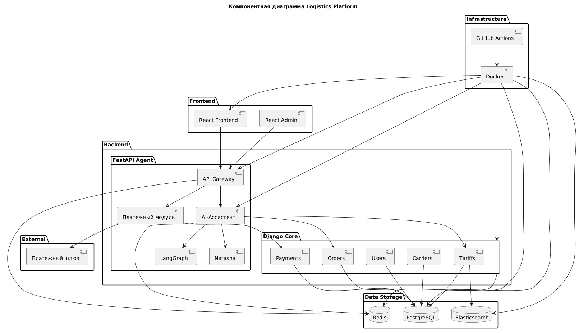
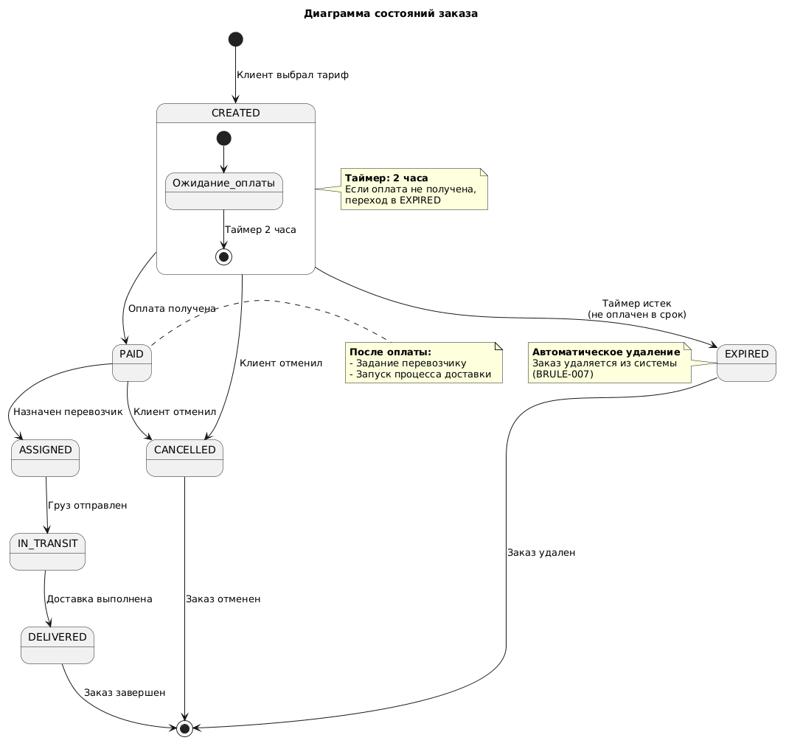
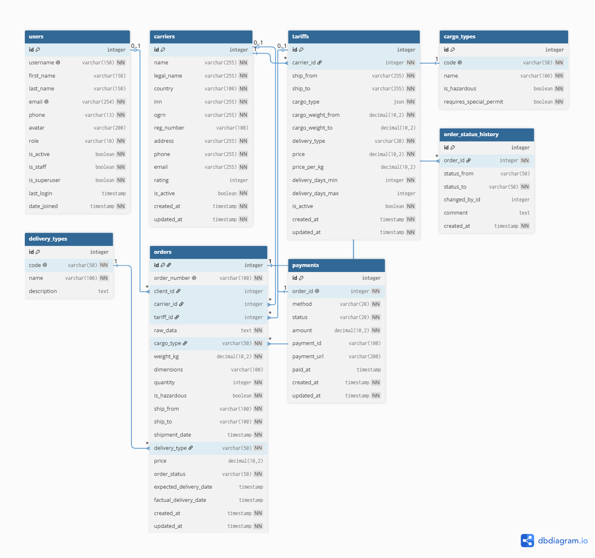

# Software Requirements Specification (SRS)

# Logistics Platform — AI-ассистент для автоматизации логистических перевозок

---

| Параметр | Значение |
|----------|----------|
| Документ | Software Requirements Specification (SRS) |
| Проект | Logistics Platform |
| Версия | 1.0 |
| Статус | Draft |
| Автор | Анастасия Гогохия |

---

# Содержание

1. Назначение документа
2. Связанные документы
3. Область применения системы

3.1. Назначение системы

3.2. Целевая аудитория

3.3. Основные бизнес-процессы, поддерживаемые системой

3.4. Границы системы
4. Акторы системы

   4.1. Пользовательские акторы

   4.2. Внешние системы

   4.3. Use Case Diagram
5. Functional Requirements

6. Требования к AI-функциональности

7. Business Rules

8. Нефункциональные требования

9. Внешние интеграции
10. Требования к данным

11. Требования к пользовательскому интерфейсу
12. Диаграммы системы

    12.1. Sequence Diagrams (Сквозной процесс)

    12.2. Component Diagram

    12.3. State Diagram

    12.4. Data Model (ER Diagram)
13. Approval

---

# 1. Назначение документа
Настоящий документ описывает системные требования к платформе
**Logistics Platform**.

SRS определяет:

- функциональные возможности системы;
- поведение системы при выполнении пользовательских сценариев;
- бизнес-правила;
- требования к данным;
- требования к внешним интеграциям;
- нефункциональные требования.

Документ используется:

| Роль | Назначение |
|-|-|
| Системный аналитик | Управление требованиями |
| Разработчики | Реализация функциональности |
| QA-инженеры | Подготовка тестовых сценариев |
| Архитектор | Проектирование решения |
| Product Owner | Проверка соответствия бизнес-целям |

---

# 2. Связанные документы

| Документ              | Назначение                       |
|-----------------------|----------------------------------|
| BRD                   | Бизнес-цели и бизнес-требования  |
| Glossary              | Термины проекта                  |
| RACI                  | Матрица ответственности          |
| User Stories          | Пользовательские сценарии        |
| Traceability matrix   | Матрица трассировки              |
| API Contract          | Описание внешнего взаимодействия |
| OpenAPI Specification | Описание REST API                |
| Test Scenarios        | Сценарии для тестов              |
| Postman Collection    | Коллекция API тестов             |

---

# 3. Область применения системы
## 3.1. Назначение системы
Logistics Platform предназначена для автоматизации процесса оформления грузовых перевозок.

Система должна обеспечивать:

- создание заявки на перевозку;
- обработку пользовательского запроса;
- определение параметров груза;
- подбор подходящих вариантов перевозки;
- создание заказа;
- управление статусом перевозки;
- проведение оплаты;
- управление перевозчиками;
- управление тарифами.

## 3.2. Целевая аудитория
- Заказчики перевозок (юридические и физические лица) — создают заявки, оплачивают, отслеживают статус.
- Перевозчики — получают заказы, управляют статусами, взаимодействуют с диспетчерами.
- Менеджеры / Администраторы — управляют перевозчиками, тарифами, обрабатывают спорные ситуации.

## 3.3. Основные бизнес-процессы, поддерживаемые системой
Система автоматизирует следующие процессы:
- Создание заявки на перевозку (через AI-чат и вручную);
- Определение параметров груза (вес, объем, тип, маршрут);
- Подбор подходящих вариантов перевозки (перевозчик, транспорт, тариф);
- Создание заказа (фиксация всех параметров);
- Управление статусом перевозки (от "Создан" до "Доставлен");
- Проведение оплаты (через интеграцию с платежным сервисом);
- Управление перевозчиками и тарифами (административная часть).

---

# 4. Акторы и системы
## 4.1 Пользовательские акторы
| Актор | Описание |
|-|-|
| CLIENT | Клиент, создающий заявку на перевозку |
| CARRIER | Перевозчик, выполняющий перевозку |
| MANAGER | Сотрудник, контролирующий выполнение заказов |
| ADMIN | Пользователь, управляющий справочниками системы |

## 4.2 Внешние системы
| Актор | Описание |
|-|-|
| Payment Service | Обработка оплаты |
| Notification Service | Отправка уведомлений |
| Maps Service | Получение данных маршрута |                      |

## 4.3. Use Case Diagram

---

# 5. Functional Requirements
# FR-001 Регистрация пользователя
## Описание
Система должна обеспечивать регистрацию нового пользователя.

## Входные данные
Пользователь указывает:

- имя;
- номер телефона;
- email;
- пароль.

## Результат
После успешной регистрации:

- создается учетная запись;
- пользователю назначается роль CLIENT;
- пользователь получает доступ к системе.

## Бизнес-связь
BR-001
## User Story
US-001

---

# FR-002 Авторизация пользователя
## Описание
Система должна обеспечивать вход пользователя в систему.

## Требования
Система должна:

- проверять учетные данные пользователя;
- предоставлять доступ согласно роли пользователя;
- запрещать доступ неавторизованным пользователям.

## Бизнес-связь
BR-001

---

# FR-003 Создание заявки через AI-чат
## Описание
Система должна предоставлять возможность создания заявки через текстовый запрос.

## Сценарий
Пользователь отправляет сообщение:
> "Нужно перевезти 500 кг оборудования из Москвы в Санкт-Петербург завтра"

Система:

1. принимает сообщение;
2. анализирует текст;
3. определяет параметры перевозки;
4. сохраняет данные заявки.

## Результат
Создается заявка со статусом CREATED.

## Связь
BR-002

BR-003

US-002

---

# FR-004 Уточнение параметров заявки
## Описание
Если обязательные параметры отсутствуют,
система должна запросить дополнительную информацию.

## Обязательные параметры:

- город отправления;
- город назначения;
- тип груза;
- вес груза.

## Пример
Система:

> Укажите вес груза

Пользователь:
> 500 кг

## Связь
BR-004

US-003

---

# FR-005 Извлечение параметров перевозки
## Описание
Система должна определять параметры перевозки из пользовательского сообщения.

## Определяемые параметры:

| Параметр | Описание |
|-|-|
| ship_from | Город отправления |
| ship_to | Город назначения |
| cargo_type | Тип груза |
| weight | Вес |
| shipment_date | Дата отправки |
| delivery_type | Тип доставки |

## Связь
BR-003

US-002

# FR-006 Подбор тарифов
## Описание
Система должна выполнять поиск подходящих вариантов перевозки
на основании параметров заявки.

## Критерии поиска:
- город отправления;
- город назначения;
- тип груза;
- вес груза;
- тип доставки.

## Требования
Система должна:

- находить доступные тарифы;
- исключать неактивные тарифы;
- отображать пользователю подходящие варианты.

## Результат
Пользователь получает список доступных вариантов перевозки.

## Бизнес-связь
BR-005
## User Story
US-004

---

# FR-007 Отображение вариантов перевозки
## Описание
Система должна отображать пользователю найденные варианты перевозки.

## Информация о варианте:

| Поле | Описание |
|-|-|
| Перевозчик | Название перевозчика |
| Стоимость | Цена перевозки |
| Срок доставки | Расчетный срок |
| Тип доставки | Вид перевозки |
| Рейтинг | Оценка перевозчика |

## Пользовательское действие
Пользователь может выбрать подходящий вариант.

## Связь
BR-006

US-004

US-005

---

# FR-008 Расчет стоимости перевозки
## Описание
Система должна рассчитывать стоимость перевозки
на основании выбранного тарифа.

## Расчет должен учитывать:
- выбранный тариф;
- параметры груза;
- дополнительные условия тарифа.

## Результат
Стоимость сохраняется в заявке.

## Связь
BR-007

---

# FR-009 Расчет срока доставки
## Описание
Система должна рассчитывать предполагаемый срок доставки.

## Результат
Пользователь должен видеть:

- ожидаемую дату доставки;
- срок перевозки.

## Связь
BR-008

---

# FR-010 Создание заказа
## Описание
После выбора варианта перевозки система должна создавать заказ.

## Заказ должен содержать:

| Поле | Описание |
|-|-|
| Номер заказа | Уникальный идентификатор |
| Клиент | Создатель заказа |
| Маршрут | Откуда и куда |
| Груз | Параметры груза |
| Перевозчик | Исполнитель перевозки |
| Тариф | Выбранный вариант |
| Стоимость | Цена заказа |
| Статус | Текущее состояние заказа |

## Начальный статус
CREATED

## Связь
BR-009

US-006

---

# FR-011 История заказов
## Описание
Система должна сохранять историю созданных заказов.

## Клиент должен видеть:
- номер заказа;
- дату создания;
- статус;
- стоимость;
- перевозчика.

## Ограничения доступа
Клиент может видеть только свои заказы.

## Связь
BR-010

US-008

---

# FR-012 Управление перевозчиками
## Описание
Администратор должен иметь возможность управлять перевозчиками.

## Возможности:
- создание перевозчика;
- изменение данных;
- просмотр списка;
- отключение перевозчика.

## Данные перевозчика:
- название;
- юридическое название;
- регистрационные данные;
- контакты;
- статус активности.

## Связь
BR-011

US-009

---

# FR-013 Управление тарифами
## Описание
Администратор должен иметь возможность управлять тарифами.

## Возможности:
- создание тарифа;
- изменение тарифа;
- просмотр списка;
- отключение тарифа.

## Тариф содержит:
- перевозчика;
- маршрут;
- тип груза;
- диапазон веса;
- стоимость;
- срок доставки.

## Связь
BR-011

US-010

---

# FR-014 Оплата заказа
## Описание
Система должна обеспечивать оплату заказа
через внешний платежный сервис.

## Сценарий:
1. Пользователь выбирает оплату.
2. Система передает данные платежному сервису.
3. Получает результат оплаты.
4. Обновляет статус платежа.

## Статусы оплаты:

| Статус | Описание |
|-|-|
| PENDING | Ожидание оплаты |
| PAID | Оплачено |
| FAILED | Ошибка оплаты |
| REFUNDED | Возврат средств |

## Связь
US-007

# FR-015 Обработка ошибок и исключительных ситуаций
## Описание
Система должна корректно обрабатывать ошибки и исключительные ситуации,
возникающие в процессе оформления заказа.

## Сценарии обработки
### Сценарий 1: Отсутствие подходящих тарифов
1. Система выполнила поиск тарифов по параметрам заявки.
2. Подходящие тарифы не найдены.
3. Система отображает сообщение:
   > "К сожалению, по вашему маршруту нет доступных перевозчиков. 
   > Попробуйте изменить дату или вес груза."
4. Пользователь может скорректировать параметры заявки.

### Сценарий 2: Отмена заказа клиентом
1. Клиент открывает заказ со статусом CREATED или PAID.
2. Нажимает кнопку "Отменить заказ".
3. Система запрашивает подтверждение.
4. Клиент подтверждает отмену.
5. Статус заказа меняется на CANCELLED.
6. Если заказ был оплачен, система инициирует возврат средств.

### Сценарий 3: Истечение времени оплаты
1. Заказ создан со статусом CREATED.
2. Запущен таймер оплаты (2 часа).
3. Оплата не поступила в течение 2 часов.
4. Статус заказа меняется на EXPIRED.
5. Заказ автоматически удаляется из активных.

### Сценарий 4: Ошибка при определении параметров
1. AI не может определить обязательные параметры из сообщения.
2. Система выводит понятное сообщение:
   > "Не удалось определить город отправления и назначения. 
   > Укажите, пожалуйста, откуда и куда нужно перевезти груз."
3. Пользователь уточняет данные.

## Бизнес-связь
BR-013

## User Story
US-011, US-012, US-013, US-014

---

# 6. Требования к AI-функциональности
# AI-001 Анализ пользовательского сообщения
Система должна анализировать текстовый запрос пользователя.

Пример:

"Перевезти мебель 500 кг Москва - Казань"

Система должна определить:

- город отправления;
- город назначения;
- тип груза;
- вес.

---

# AI-002 Извлечение параметров перевозки
Система должна извлекать:

| Параметр | Пример |
|-|-|
| Город отправления | Москва |
| Город назначения | Казань |
| Вес | 500 кг |
| Тип груза | Мебель |
| Дата | 01.08.2026 |

---

# AI-003 Уточняющие вопросы
Если система не может определить обязательный параметр,
она должна запросить дополнительные данные.

Пример:

Не определен вес:

"Укажите вес груза"

---

# AI-004 Сохранение результата анализа
Система должна сохранять полученные параметры заявки.

---

# AI-005 Контроль качества определения
Точность определения параметров должна соответствовать
целевым показателям бизнеса.

Связь:

BR-003

BR-004

# AI-006 Обработка нераспознанного запроса
Если система не может определить ни один параметр перевозки,
она должна запросить все обязательные данные в виде простых вопросов.

Пример:
Пользователь: "Привет"
Система: "Здравствуйте! Для оформления перевозки мне нужно знать:
- Откуда нужно перевезти груз?
- Куда нужно перевезти груз?
- Какой вес груза?
- Какой тип груза?"

---

# 7. Бизнес-правила

| ID          | Название                         | Суть правила                                                                                                                                                                                                 | Исключения / Доп. условия                                                                                                                          |
| :---------- | :------------------------------- | :----------------------------------------------------------------------------------------------------------------------------------------------------------------------------------------------------------- | :------------------------------------------------------------------------------------------------------------------------------------------------ |
| BRULE-001   | Обязательные параметры заказа    | Заказ не может быть создан без: города отправления, города назначения, типа груза и веса груза.                                                                                                             | Нет.                                                                                                                              |
| BRULE-002   | Активные тарифы                  | В подбор вариантов для заказа должны попадать только активные тарифы.                                                                                                                                        | Нет.                                                                                                                              |
| BRULE-003   | Активные перевозчики             | Система может назначить на заказ только активного перевозчика.                                                                                                                                               | Нет.                                                                                                                              |
| BRULE-004   | Управление статусами заказа      | Статус заказа может изменяться строго по цепочке: `CREATED → PAID → ASSIGNED → IN_TRANSIT → DELIVERED`.                                                                                                      | Возможны переходы в `EXPIRED` (по BRULE-006) и в отмененные статусы (по BRULE-007), но это не описано в цепочке.                |
| BRULE-005   | Ограничение доступа              | Пользователь видит только те данные, которые разрешены его ролью (например, `CLIENT` — только свои заказы, `ADMIN` — все данные).                                                                            | Зависит от роли.                                                                                                            |
| BRULE-006   | Время ожидания оплаты            | Заказ должен быть оплачен в течение **2 часов** с момента создания. Иначе он автоматически переходит в статус `EXPIRED`.                                                                                     | Отсчет времени начинается с момента создания заказа.                                                                                      |
| BRULE-007   | Отмена оплаченного заказа        | Клиент может отменить оплаченный заказ **только до** назначения перевозчика. После назначения — отмена только с согласия администратора.                                                                      | Правило не описывает отмену неоплаченного заказа.                                                                                    |
| BRULE-008   | Возврат средств                  | При отмене оплаченного заказа система автоматически инициирует возврат средств через платежный шлюз.                                                                                                         | Запускается только при отмене **уже оплаченного** заказа.                                                                          |

---

# 8. Нефункциональные требования
Нефункциональные требования определяют требования к качеству системы,
ограничения эксплуатации и характеристики работы системы.

# 8.1 Производительность
## PERF-001 Время ответа пользовательских операций
Система должна обеспечивать приемлемое время отклика
при выполнении основных пользовательских операций.

Требование:

- стандартные операции пользователя должны выполняться не более 2 секунд.

Примеры операций:

- открытие страницы;
- просмотр заказов;
- получение статуса заказа;
- загрузка вариантов перевозки.

---

## PERF-002 Поиск вариантов перевозки
Система должна выполнять поиск доступных вариантов перевозки
в установленное время.

Требование:

- результат поиска должен быть предоставлен пользователю
  не более чем за 3 секунды.

  
---

## PERF-003 Одновременная работа пользователей
Система должна поддерживать одновременную работу нескольких пользователей.

Целевой показатель:

- поддержка не менее 1000 активных пользовательских сессий.

---

# 8.2 Безопасность
## SEC-001 Аутентификация
Система должна обеспечивать проверку личности пользователя
перед предоставлением доступа.

Требования:

- пользователь должен пройти авторизацию;
- доступ без авторизации запрещен.

---

## SEC-002 Авторизация
Система должна обеспечивать разграничение доступа
на основании роли пользователя.

Роли:

| Роль | Доступ |
|-|-|
| CLIENT | собственные заявки и заказы |
| CARRIER | назначенные перевозки |
| MANAGER | управление заказами |
| ADMIN | управление системой |

---

## SEC-003 Защита пользовательских данных
Система должна обеспечивать защиту персональных данных пользователей.

Требования:

- персональные данные доступны только авторизованным пользователям;
- доступ к данным ограничивается ролью;
- обработка персональных данных выполняется согласно законодательству.

---

## SEC-004 Аудит действий пользователей
Система должна обеспечивать регистрацию значимых действий пользователей.

Должны фиксироваться:

- вход пользователя;
- изменение данных;
- изменение статуса заказа;
- административные операции.

---

# 8.3 Надежность
## REL-001 Обработка ошибок
Система должна корректно обрабатывать ошибки на всех уровнях.

При возникновении ошибки система должна:
- сохранить корректность данных;
- показать пользователю понятное и дружелюбное сообщение на русском языке;
- зарегистрировать ошибку в логах для последующего анализа;
- предложить пользователю альтернативный сценарий действий (если возможен).

Примеры сообщений об ошибках:
- "Не удалось найти подходящих перевозчиков. Попробуйте изменить параметры."
- "Произошла ошибка при оплате. Пожалуйста, попробуйте позже."
- "Заказ не может быть отменен, так как уже находится в пути."

---

## REL-002 Сохранность данных
Система должна обеспечивать сохранность:

- пользователей;
- заказов;
- платежных данных;
- истории изменений.

---

## REL-003 Восстановление после сбоя
После восстановления системы данные не должны быть потеряны.

---

# 9. Внешние интеграции
## INT-001 Платежный сервис
Назначение:

Обработка оплаты заказов.

Система должна:

- отправлять данные платежа;
- получать результат оплаты;
- обновлять статус платежа.

---

## INT-002 Геосервис
Назначение:

Получение информации о маршруте перевозки.

Используется для:

- расчета расстояния;
- определения срока доставки.

---
## INT-003 Сервис уведомлений

Назначение:

Отправка сообщений пользователям.

Уведомления:

- создание заказа;
- изменение статуса;
- результат оплаты.

---
# 10. Требования к данным

Полное описание структуры данных (сущности, атрибуты, связи, типы данных) представлено в Разделе 12.4. Data Model (ER Diagram) настоящего SRS.

Ниже приведены ссылочные требования к данным, которые не отражены в ER-диаграмме:

| ID          | Требование                        | Описание                                                                                                                             | Связь с ER          |
| :---------- | :-------------------------------- | :----------------------------------------------------------------------------------------------------------------------------------- | :------------------ |
| DATA-001    | Хранение пользователей            | Система должна хранить данные о пользователях (роли, контакты)                                                                       | Сущность users      |
| DATA-002    | Хранение заказов                  | Система должна хранить полную информацию о заказах (клиент, перевозчик, маршрут, груз, статус)                                       | Сущность orders     |
| DATA-003    | Хранение тарифов                  | Система должна хранить тарифы перевозчиков с привязкой к маршрутам и типам грузов                                                    | Сущность tariffs    |
| DATA-004    | Хранение платежей                 | Система должна хранить информацию о платежах по заказам                                                                              | Сущность payments   |
| DATA-005    | Хранение перевозчиков             | Система должна хранить юридическую информацию о перевозчиках                                                                         | Сущность carriers   |
| DATA-006    | Срок хранения заказов             | Система должна хранить данные о заказах не менее **5 лет** (согласно законодательству)                                               | Сущность orders     |
| DATA-007    | Срок хранения платежей            | Система должна хранить данные о платежах не менее **7 лет** (финансовый аудит)                                                       | Сущность payments   |
| DATA-008    | Архивация заказов                 | Заказы со статусом `delivered` старше **1 года** должны автоматически перемещаться в архивное хранилище                              | Сущность orders     |

# 11. Требования к пользовательскому интерфейсу
# UI-001 Интерфейс AI-чата
Система должна предоставлять пользователю
диалоговый интерфейс создания заявки.

Интерфейс должен содержать:

- поле ввода сообщения;
- историю сообщений;
- ответы системы;
- возможность отправки сообщения.

---
# UI-002 Отображение вариантов перевозки
После поиска система должна отображать карточки вариантов.

Карточка должна содержать:

- перевозчика;
- стоимость;
- срок доставки;
- тип доставки;
- рейтинг.

Пользователь должен иметь возможность выбрать вариант.

---

# UI-003 Просмотр заказа
Пользователь должен иметь возможность просматривать информацию о заказе.

Отображается:

- номер заказа;
- статус;
- маршрут;
- перевозчик;
- стоимость;
- дата доставки.

---

# UI-004 Адаптивность интерфейса
Интерфейс должен поддерживать работу
на различных размерах экранов.

---

# 12. Диаграммы системы

Диаграммы являются частью SRS и используются:

- разработчиками — для реализации требований;
- архитектором — для проектирования решения;
- QA — для подготовки тестовых сценариев;
- аналитиком — для проверки полноты требований.

## 12.1 Sequence Diagrams (Сквозной процесс)

Диаграмма последовательности описывает полный процесс взаимодействия участников системы при выполнении сквозного сценария: от запроса клиента до передачи задания перевозчику.

*Рисунок 12.1 — Полный процесс: запрос → выбор → заказ → оплата → перевозчик*

**Ответственные**

| Артефакт                                          | Ответственный                |
| ------------------------------------------------- | ---------------------------- |
| Описание бизнес-сценария                          | System Analyst               |
| Требования                                        | System Analyst               |
| Техническая реализация взаимодействия компонентов | Architect + Development Team |

**Связь с требованиями**

| Этап                      | User Story     | Functional Requirements | Data Requirements |
| ------------------------- | -------------- | ----------------------- | ----------------- |
| Отправка запроса клиентом | US-002         | FR-003                  | DATA-002          |
| Анализ текста AI          | US-002, US-003 | FR-005, AI-001, AI-002  | DATA-002          |
| Запрос уточняющих данных  | US-003         | FR-004, AI-003          | DATA-002          |
| Поиск тарифа              | US-004         | FR-006                  | DATA-003          |
| Выбор варианта перевозки  | US-005         | FR-007, FR-008          | DATA-003          |
| Создание заказа           | US-006         | FR-010                  | DATA-002          |
| Оплата заказа             | US-007         | FR-014                  | DATA-004          |

## 12.2 Component Diagram

Диаграмма компонентов описывает архитектурное представление системы:

- основные сервисы;
- внешние зависимости;
- взаимодействие компонентов.

*Рисунок 12.2 — Компонентная диаграмма системы*

Ответственный: **Architect**

Диаграмма компонентов предоставлена архитектором и включена в SRS для отображения архитектурных решений, необходимых для реализации системных требований.

**Связь компонентов с требованиями**

| Компонент       | Назначение                 | Связанные требования                           |
| --------------- | -------------------------- | ---------------------------------------------- |
| React Frontend  | Пользовательский интерфейс | UI-001, UI-002, UI-003                         |
| React Admin     | Администрирование          | FR-012, FR-013                                 |
| FastAPI Agent   | AI-обработка запросов      | FR-003, FR-004, AI-001, AI-002                 |
| Natasha         | Извлечение сущностей       | AI-002                                         |
| LangGraph       | Управление диалогом        | FR-003, AI-003                                 |
| Django Core     | Бизнес-логика              | FR-001, FR-006, FR-010, FR-011, FR-012, FR-013 |
| PostgreSQL      | Хранение данных            | DATA-001, DATA-002, DATA-003, DATA-004         |
| Redis           | Кэширование                | PERF-002, PERF-003                             |
| Elasticsearch   | Поиск тарифов              | FR-006                                         |
| Payment Gateway | Оплата                     | FR-014                                         |

## 12.3. State Diagram - Жизненный цикл заказа

Диаграмма состояний описывает жизненный цикл заказа в системе: возможные состояния и переходы между ними.

**Ответственный:**

| Артефакт                 | Ответственный    |
| ------------------------ | ---------------- |
| Бизнес-правила переходов | System Analyst   |
| Реализация переходов     | Development Team |

*Рисунок 12.3 — Диаграмма состояний заказа*

### Состояния заказа

| Статус | Описание | Действие системы |
|--------|----------|------------------|
| **CREATED** | Заказ создан, ожидает оплаты | Запускается таймер оплаты (2 часа) |
| **PAID** | Заказ оплачен | Задание передается перевозчику |
| **EXPIRED** | Время оплаты истекло | Заказ автоматически удаляется |
| **ASSIGNED** | Перевозчик назначен | Ожидание начала перевозки |
| **IN_TRANSIT** | Груз в пути | Отслеживание статуса доставки |
| **DELIVERED** | Доставка выполнена | Заказ завершен |
| **CANCELLED** | Заказ отменен | Заказ закрыт |

### Переходы между состояниями

| От | К | Условие | Описание |
|----|---|---------|----------|
| [*] | CREATED | Клиент выбрал тариф | Создание заказа |
| CREATED | PAID | Оплата получена | Заказ оплачен |
| CREATED | EXPIRED | Таймер истек | Не оплачен в срок |
| CREATED | CANCELLED | Клиент отменил | Отмена до оплаты |
| PAID | ASSIGNED | Назначен перевозчик | Перевозчик подтвердил |
| PAID | CANCELLED | Клиент отменил | Отмена после оплаты |
| ASSIGNED | IN_TRANSIT | Груз отправлен | Старт перевозки |
| IN_TRANSIT | DELIVERED | Доставка выполнена | Завершение перевозки |
| DELIVERED | [*] | - | Заказ завершен |
| EXPIRED | [*] | - | Заказ удален |
| CANCELLED | [*] | - | Заказ отменен |

**Связь с требованиями**

| Требование | Описание                   |
| ---------- | -------------------------- |
| FR-010     | Создание заказа            |
| FR-011     | Просмотр статуса заказа    |
| BRULE-004  | Правила изменения статусов |
| DATA-002   | Хранение статуса заказа    |

## 12.4 Data Model (ER Diagram)

Диаграмма описывает логическую структуру базы данных: сущности, их атрибуты и связи между ними.

**Ответственный:**

| Артефакт                 | Ответственный         |
| ------------------------ | --------------------- |
| Логическая модель данных | System Analyst        |
| Физическая модель БД     | Architect + Developer |

*Рисунок 12.4 — ER-диаграмма базы данных*

### Сущности и атрибуты

| Сущность | Атрибуты | Описание |
|----------|----------|----------|
| **users** | id, username, email, phone, avatar, role, date_joined | Пользователи системы (клиенты, перевозчики, администраторы) |
| **carriers** | id, name, legal_name, inn, ogrn, address, phone, email, rating, is_active | Перевозчики (юридические лица) |
| **tariffs** | id, carrier_id, ship_from, ship_to, cargo_type (JSON), cargo_weight_from, cargo_weight_to, delivery_type, price, price_per_kg, delivery_days_min, delivery_days_max, is_active | Тарифы перевозчиков |
| **orders** | id, order_number, client_id, carrier_id, tariff_id, raw_data, cargo_type, weight_kg, dimensions, quantity, is_hazardous, ship_from, ship_to, shipment_date, delivery_type, price, order_status, expected_delivery_date, factual_delivery_date, created_at, updated_at | Заказы на перевозку |
| **payments** | id, order_id, method, status, amount, payment_id, payment_url, paid_at, created_at, updated_at | Платежи по заказам |

### Связи между сущностями

| Связь | Тип | Описание |
|-------|-----|----------|
| users → orders | 1 : N | Один пользователь (клиент) может иметь много заказов |
| carriers → tariffs | 1 : N | Один перевозчик может иметь много тарифов |
| carriers → orders | 1 : N | Один перевозчик может выполнять много заказов |
| tariffs → orders | 1 : N | Один тариф может быть использован в многих заказах |
| orders → payments | 1 : 1 | Один заказ имеет один платеж |

### Типы данных статусов

| Поле | Возможные значения |
|------|-------------------|
| users.role | admin, client, carrier, manager |
| orders.order_status | created, assigned, in_transit, cancelled, delivered |
| orders.cargo_type | documents, package, pallet, furniture, vehicle, hazmat, liquid, other |
| orders.delivery_type | standard, express |
| payments.method | prepaid, postpaid |
| payments.status | pending, paid, failed, refunded |
| carriers.is_active | true, false |
| tariffs.is_active | true, false |

**Связь с требованиями**

| Сущность | Требования                       |
| -------- | -------------------------------- |
| users    | FR-001, FR-002, DATA-001         |
| orders   | FR-003, FR-010, FR-011, DATA-002 |
| carriers | FR-012, DATA-005                 |
| tariffs  | FR-006, FR-007, FR-013, DATA-003 |
| payments | FR-014, DATA-004                 |

---

# 13. Approval

Документ должен быть согласован следующими участниками:

| Роль | Ответственный | Статус |
|-|-|-|
| Бизнес-заказчик | | |
| Product Owner | | |
| Системный аналитик | Анастасия Гогохия | Draft |
